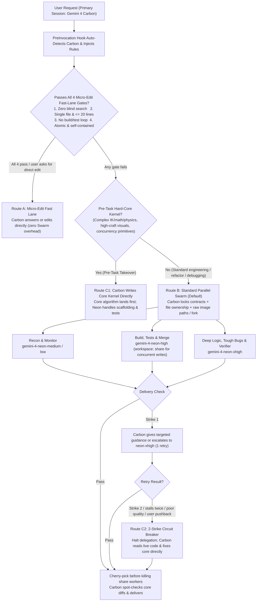

<p align="center">
  
</p>

<h1 align="center">Carbon-Neon Orchestrator</h1>

<p align="center">
  <strong>Carbon Leads the Architecture · Neon Ships at Full Throttle — A Hybrid Multi-Agent Orchestration Plugin for Antigravity</strong>
</p>

<p align="center">
  
  
  
  
  <a href="https://linux.do"></a>
</p>

<p align="center"><strong>English</strong> · <a href="./README_CN.md">简体中文</a></p>

---

## Why Carbon-Neon Orchestrator?

In real-world software engineering, no single model hits the sweet spot between **deep architectural reasoning** and **high-throughput parallel execution**:

- **Running Gemini 4 Carbon solo for everything**: Carbon excels at system architecture, math/physics modeling, and gnarly root-cause debugging—but using it for repo-wide scans, multi-file boilerplate, unit test suites, and repetitive build/lint cycles bloats your main context window, drags out turnaround time, and burns through quota fast.
- **Running Neon alone—or blindly delegating every prompt**: Neon flies through implementation work, yet struggles when asked to solo intricate architecture, subtle concurrency kernels, or hard algorithmic tradeoffs. Worse, dogmatic delegation spawns swarm overhead for a one-line config tweak, drops nuance through telephone-game summaries, and gets trapped in endless retry loops when a worker hits a wall.

**Carbon-Neon Orchestrator** brings a disciplined hybrid workflow to Antigravity whenever your main session runs **Gemini 4 Carbon**:

- **Carbon as Lead Architect**: Decomposes requirements, locks interface contracts, enforces strict **One-Writer-Per-File** ownership, spot-checks core diffs before final delivery, and handles both tiny micro-edits and hard-core kernels firsthand.
- **Parallel Neon Workers**: Dispatches tiered workers (`gemini-4-neon-medium` / `low`, `high`, and `xhigh`) through Antigravity's native `swarm` tool to parallelize reconnaissance, implementation, testing, and verification—automatically isolating concurrent writers with `workspace: "share"`.

---

## 3-Way Smart Routing Architecture



---

## Key Features

1. **Auto-Activation on `Gemini 4 Carbon` & Seamless `/compact` Recovery (`PreInvocation` Hook)**
   - Automatically activates orchestration rules whenever the primary session runs **Gemini 4 Carbon** (covering High / Medium / Low tiers, with fallback parsing of `Model Selection` switch logs) and deduplicates per session so it never bloats your context.
   - Automatically emits a pause notice and returns to standard direct execution if you switch to another model (Neon, Flash, Claude, etc.), while staying completely silent inside `<swarm_worker>` sub-agents.
   - **Step-rewind resilience for `/compact`**: Tracks `initialNumSteps` and automatically re-injects orchestration rules after a context compaction or step rewind—no mid-session amnesia.

2. **4-Gate Micro-Edit Fast Lane (`<= 20 lines`)**
   - Avoids dogmatic delegation: pure Q&A, or edits that pass all four quantitative gates—**known target file (zero blind search)**, **single file with `<= 20` changed lines**, **no build/test loop**, and **atomic self-contained scope**—are executed directly by Carbon in seconds with zero swarm startup latency.
   - Cross any single gate (`>= 2` files, `> 20` lines, call-graph tracing, or build/test verification) and the task routes straight to the Neon swarm.

3. **Zero-Loss Context Handoff (Raw Image Path Passthrough + `fork: "coordinator"`)**
   - Whenever you attach UI screenshots, design mockups, or error images, Carbon passes the exact absolute file paths verbatim in the worker brief and requires Neon to inspect the originals with `read_file` first—eliminating lossy text paraphrases.
   - For heavy multi-turn design discussions packed with implicit constraints, Carbon can spawn workers with `swarm{action:"add", ..., fork:"coordinator"}` to inherit live coordinator memory directly.

4. **Pre-Task Hard-Core Takeover & 2-Strike Carbon Circuit Breaker**
   - **Pre-Task Takeover**: For high-precision math, physics/IK solvers, intricate single-file visual animations, or low-level concurrency primitives, Carbon writes the core kernel itself and hands surrounding plumbing and tests to Neon in parallel.
   - **2-Strike Circuit Breaker**: If Neon fails twice on the same issue, loops without progress, ships subpar output, or triggers user pushback, delegation halts immediately—Carbon inspects the live files and resolves the core problem directly.

---

## Quick Install

Clone the repository directly into your Antigravity global plugins directory with a single command:

```bash
git clone https://github.com/RiseToTop/carbon-neon-orchestrator.git ~/.gemini/config/plugins/carbon-neon-orchestrator
```

- **Zero external dependencies**: Uses only the system's built-in `python3` and resolves paths dynamically via `Path(__file__).resolve().parent.parent` and `${PLUGIN_ROOT}`—no hardcoded machine paths.
- **Live reload without restart**: Antigravity automatically discovers plugins placed under `~/.gemini/config/plugins/`.
- **One-click toggle**: Enable or disable **Carbon-Neon Orchestrator** anytime from Antigravity's **Skills & Customizations** panel.

---

## Repository Structure & Customizing Effort Tiers

```text
carbon-neon-orchestrator/
├── plugin.json                                     # Antigravity plugin manifest & suggested prompts
├── hooks.json                                      # PreInvocation hook declaration (portable Python entry)
├── hooks/
│   └── auto_carbon_orchestrator.py                 # Carbon detection, deduplication, /compact recovery & worker silence
├── skills/
│   └── carbon-neon-orchestrator/
│       ├── SKILL.md                                # Full Carbon + Neon orchestration spec & 3-way routing rules
│       └── references/
│           └── playbook.md                         # Routing quick-reference, zero-loss brief templates & share merge protocol
├── assets/
│   └── logo.svg                                    # Plugin vector icon
├── LICENSE                                         # MIT License
├── README.md                                       # English documentation (default)
└── README_CN.md                                    # Simplified Chinese documentation
```

### Default Effort Tier Matrix

Out of the box, the plugin maps each engineering role to a dedicated model tier:

| Role | Default Model ID | Primary Responsibilities |
| :--- | :--- | :--- |
| **Lead Architect / Final Reviewer / Fallback** | `gemini-4-carbon-high` (primary session) | System design, interface contracts, fast-lane micro-edits, hard-core kernels, 2-strike takeover |
| **Primary Builder (Default Worker)** | `gemini-4-neon-high` | Multi-file feature implementation, refactoring, unit tests, build verification, safe merges (`workspace: "share"`) |
| **Deep Logic & Strict Verifier** | `gemini-4-neon-xhigh` | Complex state machines & async flows, tough root-cause debugging, deep code & regression review |
| **Fast Recon & Swarm Monitor** | `gemini-4-neon-medium` / `gemini-4-neon-low` | Read-only codebase reconnaissance, log distillation, `swarm_monitor` stall prevention |

### How to Customize Tiers & Thresholds

1. **Change default Neon effort tiers**:
   - Edit `ACTIVATE_SYSTEM_MSG` in `hooks/auto_carbon_orchestrator.py` (the concise directive injected on first Carbon activation).
   - Keep `skills/carbon-neon-orchestrator/SKILL.md` (Route B) and `skills/carbon-neon-orchestrator/references/playbook.md` in sync—for example, dial default builders down to `gemini-4-neon-medium` for maximum speed or default to `gemini-4-neon-xhigh` for heavier reasoning.
2. **Tune the fast-lane line threshold or state directory**:
   - To loosen or tighten the micro-edit line limit (default `<= 20 lines`), update both `hooks/auto_carbon_orchestrator.py` and `skills/carbon-neon-orchestrator/SKILL.md`.
   - Session state markers are written to `PLUGIN_DATA` when set (falling back to `agy-carbon-neon-orchestrator-state` inside the system temp directory) with built-in automatic cleanup of stale files.

---

## Community & Acknowledgements

This project launched in and is actively discussed within the [LINUX DO](https://linux.do) community. Huge thanks to the [LINUX DO](https://linux.do) community and everyone who shared testing feedback, ideas, and improvements. Pull requests, workflow tweaks, and issues are always welcome!

---

## License

Released under the [MIT License](LICENSE).
