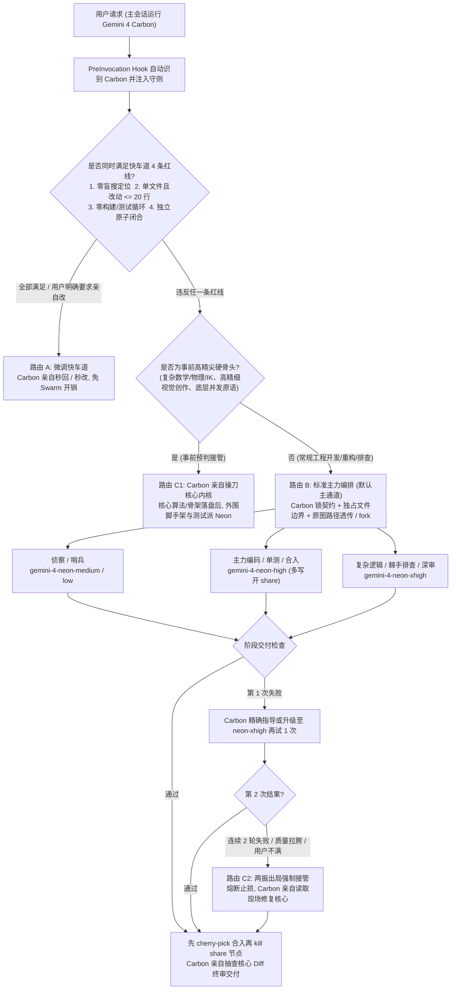

<p align="center">
  
</p>

<h1 align="center">Carbon-Neon Orchestrator</h1>

<p align="center">
  <strong>主 Carbon 统筹攻坚 · 副 Neon 高速干活 —— 面向 Antigravity 的智能混合编排插件</strong>
</p>

<p align="center">
  
  
  
  
  <a href="https://linux.do"></a>
</p>

<p align="center"><a href="./README.md">English</a> · <strong>简体中文</strong></p>

---

## 为什么需要 Carbon-Neon Orchestrator？

在复杂软件工程任务中，单一模型往往难以兼顾**顶层架构推理质量**与**大批量并行执行吞吐**：

- **全程用 Gemini 4 Carbon 单打独斗**：顶级架构设计、数学/物理建模和疑难攻坚能力无可挑剔，但在代码库广域扫描、多文件样板开发、单测补全和反复跑构建/Lint 时，主会话上下文膨胀快、响应周期长、配额消耗高。
- **盲目把所有活甩给子代理**：连改一行配置也要拉起 Swarm 集群得不偿失；只靠文字转述截图/上下文容易「传话失真」；遇到子模型啃不动的硬骨头若无限重试，只会原地打转浪费轮次。

**Carbon-Neon Orchestrator** 借鉴 Antigravity 原生 Orchestrator 思想并补齐工程落地细节，在主会话选用 **Gemini 4 Carbon** 时自动激活智能混合编排模式：

- **Carbon 坐镇中枢**：专职需求拆解、锁定接口契约、划定独占文件边界（One Writer Per File）、终审抽查 Diff，并在「极小微调」与「高难硬骨头」上果断亲自出手。
- **Neon 集群攻坚**：通过原生 `swarm` 工具按任务复杂度分级调度 `gemini-4-neon-medium` / `high` / `xhigh` 并行执行侦察、编码、单测与安全合入（多写并发自动启用 `workspace: "share"` 隔离工作区）。

---

## 三路智能路由架构



---

## 核心特性

1. **按模型自动识别与无感恢复（`PreInvocation` Hook）**
   - 检测到主会话运行 `Gemini 4 Carbon`（支持 High / Medium / Low 及 `Model Selection` 切换日志回退识别）时自动注入编排守则，并在单会话内自动去重，不重复占用上下文。
   - 当会话切换到其他模型（如 Neon、Flash、Claude 等）时自动下发暂停提示并恢复常规直接执行；在 `<swarm_worker>` 子节点中自动静默，零干扰。
   - **支持 `/compact` 与步数回退自动恢复**：检测 `initialNumSteps` 回退后自动重新注入编排规则，长对话压缩后不“失忆”。

2. **4 条量化红线的「单文件 ≤ 20 行微调快车道」**
   - 拒绝教条式派活：纯口头答疑，或同时满足「已知文件无需盲搜」「最多改 1 个文件且改动 ≤ 20 行」「无需构建/测试循环」「独立原子闭合」4 条红线时，由 Carbon 直接秒改回复，零集群启动延迟。
   - 只要触碰任一红线（≥ 2 个文件、> 20 行代码、查调用链或需跑单测构建），立即切换 Neon 集群通道。

3. **原图路径透传 + `fork: "coordinator"` 零损耗上下文传递**
   - 用户上传 UI 截图、设计稿或报错图时，强制在 Brief 中原样透传所有图片与参考文件的绝对路径，要求 Neon 开工第一步直接 `read_file` 看原图，杜绝“传话筒失真”。
   - 面对多轮推演形成的重上下文场景，支持通过 `swarm{action:"add", ..., fork:"coordinator"}` 热派生主控记忆，免去长篇摘要遗漏隐含约束。

4. **事前高难亲自操刀 + 事中「两振出局」Carbon 王牌接管**
   - **事前预判**：对高难数学/物理/IK 仿真、高精细度单文件视觉动画、底层并发原语等硬核灵魂模块，由 Carbon 亲手编写核心内核，外围业务与测试再交给 Neon 并行补齐。
   - **事中两振熔断**：同一问题 Neon 连续 2 轮修不好、原地打转、交付质量拉胯或用户表达不满时，立即停止继续派 Neon 盲试，由 Carbon 亲自读现场源码接管攻坚。

---

## 快速安装

在终端执行以下一行命令，将仓库克隆到 Antigravity 全局插件目录即可：

```bash
git clone https://github.com/RiseToTop/carbon-neon-orchestrator.git ~/.gemini/config/plugins/carbon-neon-orchestrator
```

- **无需重启，实时生效**：Antigravity 会自动发现 `~/.gemini/config/plugins/` 下的插件。
- **一键开关**：可在 Antigravity 左侧 **Skills & Customizations** 面板中找到 **Carbon-Neon Orchestrator** 随时开启或关闭。
- **零硬编码路径**：Hook 脚本基于 `Path(__file__).resolve().parent.parent` 与 `${PLUGIN_ROOT}` 动态解析路径，支持跨机器直接克隆使用（依赖系统自带 `python3`）。

---

## 目录结构

```text
carbon-neon-orchestrator/
├── plugin.json                                     # Antigravity 插件清单与推荐提示词
├── hooks.json                                      # PreInvocation 钩子声明（可移植 Python 调用）
├── hooks/
│   └── auto_carbon_orchestrator.py                 # Carbon 模型检测、去重、/compact 恢复与静默逻辑
├── skills/
│   └── carbon-neon-orchestrator/
│       ├── SKILL.md                                # 主 Carbon 副 Neon 完整编排规范与三路路由红线
│       └── references/
│           └── playbook.md                         # 路由速查矩阵、防失真 Brief 模板与 share 合入协议
├── assets/
│   └── logo.svg                                    # 插件矢量图标
├── LICENSE                                         # MIT 开源协议
├── README.md                                       # 英文默认文档
└── README_CN.md                                    # 简体中文文档
```

---

## 自定义 Neon 思考档位与路由策略

本插件默认采用四级 Neon 分工矩阵，你也可以按团队习惯或配额情况灵活调整：

| 角色类型 | 默认模型 ID | 适用任务 |
| :--- | :--- | :--- |
| **总指挥 / 终审 / 王牌兜底** | `gemini-4-carbon-high`（主会话） | 架构设计、契约锁定、微调快车道、高难核心、两振接管 |
| **常规开发主力（默认）** | `gemini-4-neon-high` | 多文件功能实现、模块重构、单测编写、构建验证、代码合入 |
| **高难逻辑 / 严苛审查尖兵** | `gemini-4-neon-xhigh` | 复杂状态机与异步逻辑、棘手 Bug 根因排查、深度 Verifier |
| **快速侦察 / 哨兵监控** | `gemini-4-neon-medium` / `gemini-4-neon-low` | 代码库只读摸底、日志提炼、`swarm_monitor` 防卡死监控 |

### 如何自定义档位或阈值？

1. **修改默认 Neon 思考档位**：
   - 编辑 `hooks/auto_carbon_orchestrator.py` 中的 `ACTIVATE_SYSTEM_MSG`（模型切换首次注入的精简指令）；
   - 同步更新 `skills/carbon-neon-orchestrator/SKILL.md` 第 1 节「路由 B」与 `references/playbook.md` 中的模型 ID（例如将常规主力调整为 `gemini-4-neon-medium` 以追求极致速度，或默认全线启用 `gemini-4-neon-xhigh`）。
2. **调整快车道红线或状态目录**：
   - 如需放宽/收紧微调快车道的改动行数阈值（默认 `≤ 20 行`），同步修改 `hooks/auto_carbon_orchestrator.py` 与 `skills/carbon-neon-orchestrator/SKILL.md` 即可；
   - 状态标记默认写入环境变量 `PLUGIN_DATA` 指向的目录（未设置时自动回退至系统临时目录下的 `agy-carbon-neon-orchestrator-state`），并内置旧文件自动清理逻辑，无需人工维护。

---

## 社区与致谢

本项目首发并活跃交流于 [LINUX DO](https://linux.do) 社区。感谢 [LINUX DO](https://linux.do) 社区与各位佬友的支持、交流与宝贵反馈，欢迎在社区或 GitHub Issues 中分享你的使用心得与改进建议！

---

## License

本项目基于 [MIT License](LICENSE) 开源。
